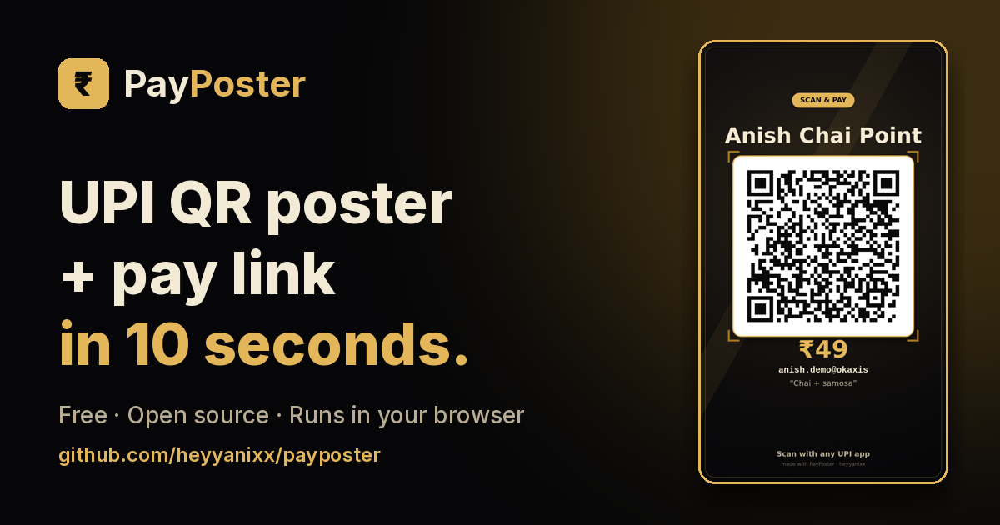
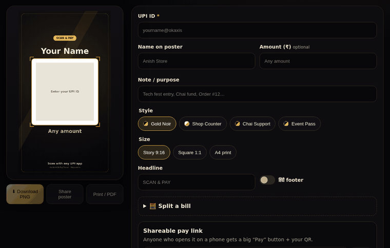
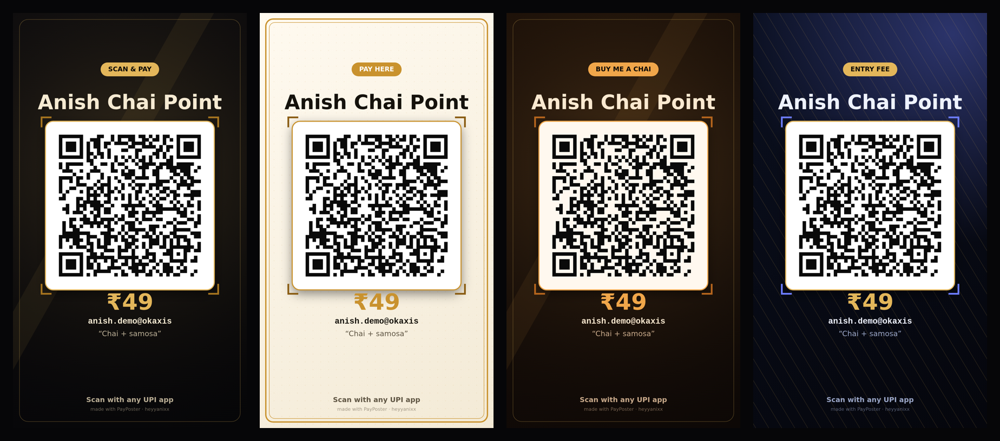
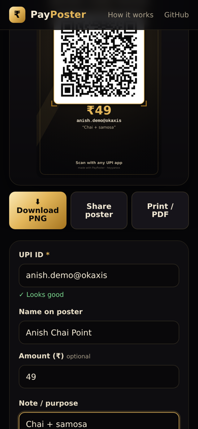
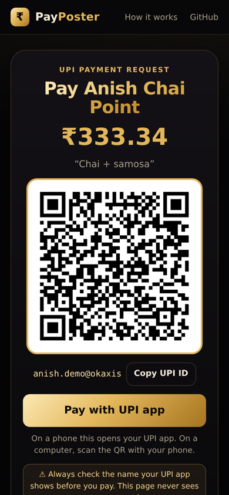

<div align="center">

<a href="https://heyyanixx-payposter.sites.tab.bot/"></a>

<h1>PayPoster</h1>

<p><b>Free UPI QR poster + shareable pay link maker — for small shops, creators, college fests &amp; friends splitting a bill.</b><br>
Runs 100% in your browser. Nothing is uploaded. No sign-up.</p>

<p>
<a href="https://github.com/heyyanixx/payposter/releases"></a>
<a href="LICENSE"></a>
<a href="https://heyyanixx-payposter.sites.tab.bot/"></a>
<a href="https://github.com/heyyanixx"></a>
</p>
<p>
<a href="#how-it-works"></a>
<a href="#how-it-works"></a>
<a href="#privacy"></a>
<a href="#quick-start"></a>
<a href="https://www.youtube.com/@smart_anish69"></a>
<a href="https://www.instagram.com/heyyy.anixx_/"></a>
</p>

<a href="https://github.com/heyyanixx"></a>

<h3>
<a href="https://heyyanixx-payposter.sites.tab.bot/">Live demo</a> ·
<a href="#poster-styles">Showcase</a> ·
<a href="https://github.com/heyyanixx">Author</a>
</h3>
<p>
<a href="#quick-start">Quick start</a> ·
<a href="#how-it-works">How it works</a> ·
<a href="#features">Features</a> ·
<a href="#faq">FAQ</a> ·
<a href="#contributing">Contributing</a>
</p>



</div>

## Why

Every chai stall, college fest desk and small creator in India takes UPI — but the QR on the counter is usually a blurry photo of a bank sticker, and "send me ₹315 each" in a group chat means four people typing a UPI ID by hand.

**PayPoster** turns your UPI ID into a clean, printable poster and a pay link in about 10 seconds:

- **Poster** → download as PNG (Story 9:16, Square, or A4 for print)
- **Pay link** → anyone who opens it on a phone gets a big **Pay** button that opens their UPI app with your ID, name, amount and note already filled
- **Split bill** → total ÷ people, rounded up to the paisa so nobody is short

## Features

| | |
|---|---|
| 🎨 **4 poster styles** | Gold Noir, Shop Counter (print-friendly), Chai Support (creators), Event Pass (fests) |
| 📐 **3 sizes** | Story 1080×1920 · Square 1080×1080 · A4 1240×1754 |
| 🔗 **Shareable pay page** | `…/#/pay?pa=…&am=…` — QR + "Pay with UPI app" button + copy UPI ID |
| 🧮 **Split bill** | Per-person amount, rounded **up** so the total is always covered |
| 💬 **WhatsApp share** | One tap to send the pay link |
| 🖨️ **Print / PDF** | A4 poster via your browser's print dialog |
| 🇮🇳 **Hindi footer** | Optional "किसी भी UPI ऐप से स्कैन करें" line |
| ✅ **Validation** | Catches a missing `@`, bad amounts (max 2 decimals) before you print a broken QR |
| 🔒 **Private** | No server, no analytics, no cookies — last inputs saved only in your browser |

## Poster styles

<p align="center"></p>

<p align="center">


</p>

## Quick start

**Use it:** open **https://heyyanixx-payposter.sites.tab.bot/** → type your UPI ID → pick a style → **Download PNG**.

**Run it locally** (no install, no build):

```bash
git clone https://github.com/heyyanixx/payposter.git
cd payposter
python3 -m http.server 8080      # or any static server
# open http://localhost:8080
```

**Run the tests:**

```bash
node --test test/                  # unit tests: UPI link building, validation, split bill
pip install playwright opencv-python-headless numpy
python3 test/e2e.py http://localhost:8080/ ./qa   # browser tests: every style/size QR is decoded back with OpenCV
```

## How it works

1. Your inputs become a standard UPI deep link:
   `upi://pay?pa=<UPI ID>&pn=<name>&am=<amount>&cu=INR&tn=<note>` (every value URL-encoded).
2. That link is encoded into a QR code (error-correction level **M**) and drawn on a `<canvas>` together with your name, amount and style — all in the browser.
3. The pay link is just this page with your details in the URL hash (`#/pay?...`). The hash never reaches any server.

```
index.html      UI
styles.css      black & gold theme, mobile-first
js/upi.js       pure functions: validate, build upi:// link, pay-page link, split bill (unit-tested)
js/poster.js    canvas poster renderer (4 styles × 3 sizes)
js/app.js       wiring: live preview, download, share, print, pay page
vendor/qrcode.js  QR encoder (qrcode-generator by Kazuhiko Arase, MIT)
```

## Privacy

There is no backend. The page makes no network requests after it loads. Your last inputs are kept in `localStorage` on your own device — tap **Clear** to remove them.

## FAQ

<details><summary><b>Does it work with every UPI app?</b></summary>

It uses the standard `upi://pay` format that UPI apps read. Some apps may ignore the pre-filled amount or note when paying a personal (non-merchant) UPI ID — the payer can still type it in.
</details>

<details><summary><b>Is this a payment gateway?</b></summary>

No. PayPoster never touches money. It only makes a QR and a link; the payment happens inside the payer's own UPI app. Payers should always check the name their app shows before paying.
</details>

<details><summary><b>Can a business use it?</b></summary>

It's great for personal collections, small stalls, fests and creators. If you need GST invoices, refunds or settlement reports, use a merchant QR from your bank or a payment gateway.
</details>

## Roadmap

- [ ] More poster styles (Diwali/Holi festive, minimal white)
- [ ] Custom logo / photo on the poster
- [ ] Batch mode: one poster per amount (₹10 / ₹20 / ₹50 counter cards)
- [ ] Offline install (PWA)

## Contributing

Issues and PRs are welcome — new poster styles are the easiest first PR (add an entry to `STYLES` in `js/poster.js`). See [CONTRIBUTING.md](CONTRIBUTING.md).

## License

[MIT](LICENSE) © 2026 Anish ([@heyyanixx](https://github.com/heyyanixx)). The vendored QR encoder is MIT-licensed by Kazuhiko Arase — see [THIRD_PARTY_NOTICES.md](THIRD_PARTY_NOTICES.md).

<sub>Not affiliated with NPCI, any bank or any UPI app. "UPI" is used only to describe compatibility. "QR Code" is a registered trademark of DENSO WAVE INCORPORATED.</sub>

<div align="center"><sub>Built in public by a BCA student from Dumka, Jharkhand · <a href="https://github.com/heyyanixx">more of my projects</a></sub></div>
